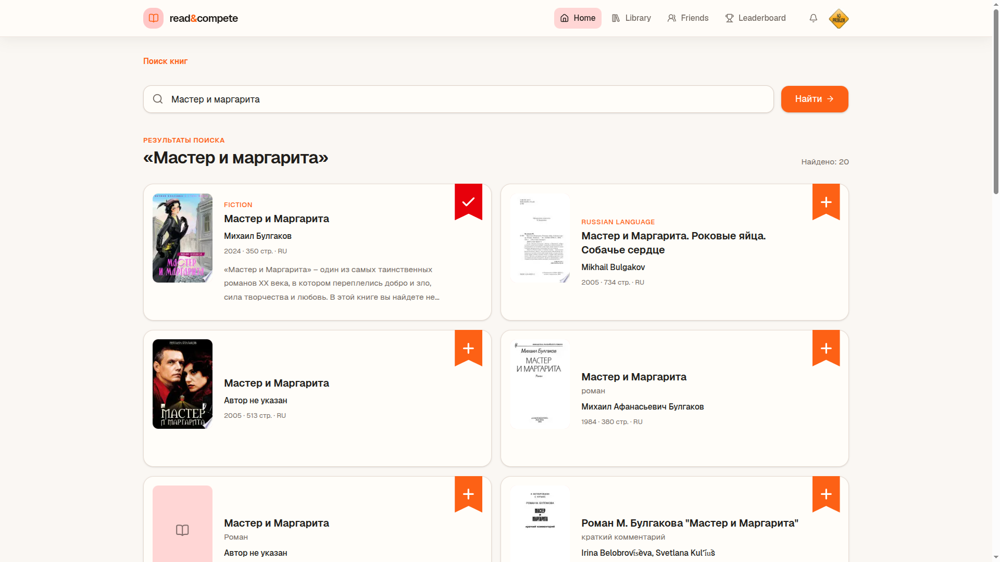
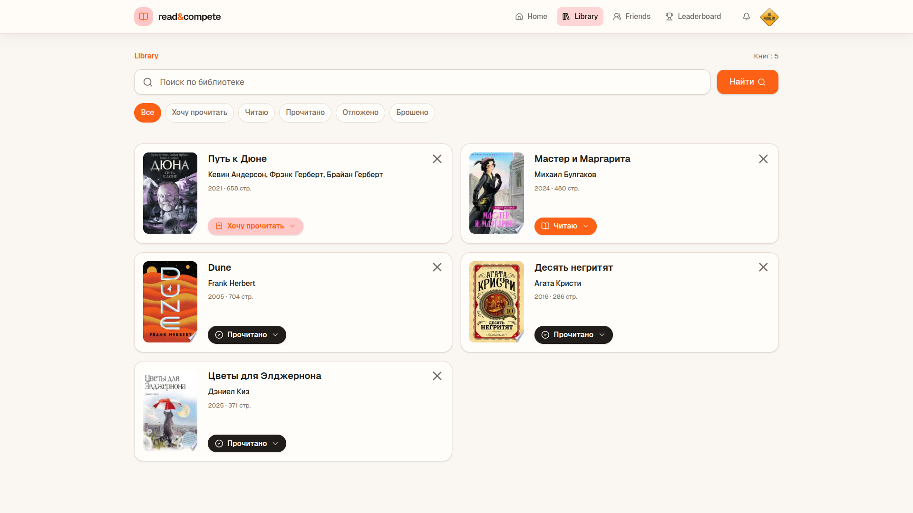
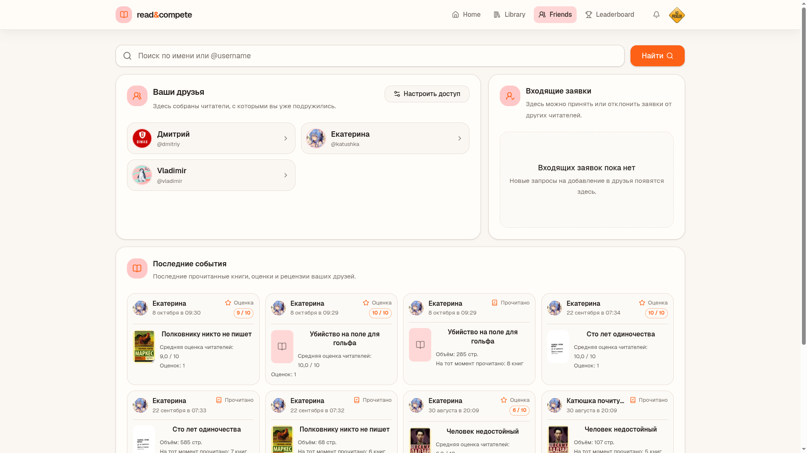

# Read & Compete

Read & Compete — fullstack-приложение для ведения личной библиотеки и совместного чтения. Пользователь может находить книги, отмечать статус чтения, публиковать оценки и рецензии, добавлять друзей и сравнивать читательскую активность.

Проект построен на Next.js App Router: интерфейс, серверная логика и HTTP-маршруты находятся в одном TypeScript-приложении, а данные хранятся в PostgreSQL через Prisma ORM.

**Демо:** [https://readcompete.ru](https://readcompete.ru)

## Возможности

### Книги и личная библиотека

- Поиск изданий через Google Books API.
- Страница книги с обложкой, авторами, описанием, издательством, языком и количеством страниц.
- Добавление и удаление книги со страницы поиска, страницы книги или личной библиотеки.
- Пять статусов чтения: «Хочу прочитать», «Читаю», «Прочитано», «Приостановлено» и «Брошено».
- Поиск по названию и авторам, фильтрация библиотеки по статусу.
- Сохранение даты завершения и числа прочитанных книг на момент завершения.

### Оценки и обсуждение

- Оценка книги по шкале от 1 до 10 и необязательная текстовая рецензия.
- Средняя оценка книги и количество выставленных оценок.
- Лайки и дизлайки текстовых рецензий.
- Комментарии к рецензиям с добавлением и удалением собственных комментариев.

### Профили и друзья

- Профиль с уникальным `@username`, редактируемым именем и ссылкой для публикации.
- Статистика по прочитанным книгам, страницам и выставленным оценкам.
- Поиск пользователей по имени или username.
- Отправка, принятие, отклонение и отмена заявок в друзья; удаление из друзей.
- Индивидуальная настройка доступа друга к библиотеке.
- Отдельная настройка видимости последних прочитанных книг для пользователей не в друзьях.
- Лента последних событий друзей: завершённые книги, оценки и рецензии.

### Лидерборд и уведомления

- Рейтинг по количеству прочитанных книг или страниц.
- Периоды: неделя, месяц, год и всё время.
- Переключение между общим рейтингом и рейтингом среди друзей.
- Уведомления о новых заявках, принятии дружбы и комментариях к рецензиям.
- Отметка уведомлений прочитанными и удаление прочитанных уведомлений.

## Технологии

| Область             | Используемые технологии                                                                     |
| ------------------- | ------------------------------------------------------------------------------------------- |
| Frontend            | React 19, TypeScript, Tailwind CSS 4, Radix UI, shadcn/ui, Lucide React                     |
| Fullstack-фреймворк | Next.js 16, App Router, Server Components, Server Actions, Route Handlers, Cache Components |
| База данных         | PostgreSQL, Prisma ORM 7, `@prisma/adapter-pg`, `pg`                                        |
| Авторизация         | Auth.js 5, Prisma Adapter, OAuth через GitHub и Google, database-сессии                     |
| Внешний API         | Google Books API                                                                            |
| Инфраструктура      | Vercel, Neon PostgreSQL                                                                     |
| Инструменты         | npm, ESLint, Prisma Migrate, Turbopack                                                      |

## Архитектура

Основные части проекта разделены по назначению:

```text
app/
  (app)/                 защищённые страницы приложения
  api/                   Auth.js и HTTP Route Handlers
  generated/prisma/      сгенерированный Prisma Client
components/
  books/                 поиск, библиотека и карточки книг
  friends/               список друзей, заявки и лента событий
  reviews/               оценки, рецензии, реакции и комментарии
  profile/               профиль, статистика и настройки доступа
  notifications/         центр уведомлений
  ui/                    базовые UI-компоненты
lib/
  books/                 запросы и изменения библиотеки
  friends/               дружба, доступ и социальная активность
  reviews/               серверная логика рецензий и комментариев
  notifications/         создание, чтение и очистка уведомлений
  leaderboard/           фильтры периодов и расчёт рейтинга
  profile/               данные профиля, username и приватность
prisma/
  schema.prisma          модели и связи PostgreSQL
  migrations/            история миграций
```

Страницы и layouts по умолчанию являются Server Components и получают данные через функции из `lib`. Интерактивные Client Components вызывают Server Actions для изменений, а Route Handlers используются для Auth.js, загрузки комментариев и обновления уведомлений.

Prisma Client создаётся только на сервере через PostgreSQL driver adapter. После изменений данных приложение обновляет связанные страницы и кэш с помощью `updateTag` и `revalidatePath`.

## Технические решения

### 1. OAuth и обязательная настройка профиля

Auth.js работает через Prisma Adapter и хранит OAuth-аккаунты и сессии в PostgreSQL. Поддерживаются GitHub и Google. После первого входа пользователь проходит отдельный welcome-экран, выбирает отображаемое имя и уникальный username; до завершения этого шага защищённая часть приложения недоступна.

Сессия проверяется в защищённом layout и повторно внутри серверных операций, которые изменяют пользовательские данные. Внутренние пути возврата после входа валидируются отдельно, чтобы приложение не принимало внешний URL как `returnPath`.

### 2. Модель дружбы и управление доступом

Одна запись `FriendRequest` представляет и заявку, и принятую дружбу. Канонический `pairKey` одинаков для направлений `A → B` и `B → A`; уникальный индекс не позволяет создать две встречные записи для одной пары пользователей. Миграция дополнительно содержит PostgreSQL `CHECK`-ограничения для участников и значения ключа.

Разрешение на просмотр библиотеки хранится отдельно для каждого направления дружбы. Поэтому каждый пользователь независимо определяет, видит ли конкретный друг его библиотеку. Проверка выполняется до запроса закрытых книг, а не только при отображении интерфейса.

### 3. Согласованные изменения данных

Операции, состоящие из нескольких зависимых запросов, выполняются в Prisma-транзакциях с уровнем изоляции `Serializable`. При конфликте записи `P2034` операция повторяется до трёх раз.

Этот механизм используется, в частности, при смене статуса книги и социальных действиях. Он позволяет согласованно обновлять дату завершения, снимок количества прочитанных книг и связанные записи при параллельных запросах.

### 4. Интеграция с Google Books

API-ключ используется только в серверном модуле. Ответ Google Books преобразуется в собственный тип приложения, HTML в описании очищается, а отсутствующие поля приводятся к предсказуемым значениям.

Внешние запросы имеют таймаут и до трёх попыток для сетевых ошибок, HTTP 429 и 5xx. Результаты поиска кэшируются на 15 минут, а страница книги сначала проверяет локальную БД и обращается к Google только для ещё не сохранённого издания.

### 5. Серверный рендеринг и обновление кэша

Проект использует Cache Components, Suspense, route-level loading-состояния и error boundaries. Библиотека пользователя кэшируется с отдельным тегом, поэтому её изменение инвалидирует данные конкретного пользователя и связанные страницы книги и профиля.

Формы и интерактивные кнопки хранят только UI-состояние на клиенте. Авторизация, валидация входных данных, проверка владельца записи и операции с Prisma остаются на сервере.

## Локальный запуск

### Требования

- Node.js 20.9 или новее.
- npm.
- PostgreSQL-совместимая база данных.
- OAuth-приложения GitHub и Google.
- API-ключ Google Books.

### 1. Клонирование и установка

```bash
git clone https://github.com/BadMood1/read-and-compete-proj.git
cd read-and-compete-proj
npm install
```

`postinstall` автоматически генерирует Prisma Client.

### 2. Переменные окружения

Создайте `.env` из примера:

```bash
cp .env.example .env
```

Необходимые переменные:

```dotenv
DATABASE_URL=
AUTH_SECRET=
AUTH_GITHUB_ID=
AUTH_GITHUB_SECRET=
AUTH_GOOGLE_ID=
AUTH_GOOGLE_SECRET=
GOOGLE_BOOKS_API_KEY=
```

Значения секретов не должны попадать в Git. Для локальных OAuth-приложений укажите callback URL:

```text
http://localhost:3000/api/auth/callback/github
http://localhost:3000/api/auth/callback/google
```

### 3. Подготовка базы данных

Примените миграции из репозитория:

```bash
npm run db:migrate:deploy
```

### 4. Запуск приложения

```bash
npm run dev
```

Приложение будет доступно по адресу [http://localhost:3000](http://localhost:3000).

### Основные команды

| Команда                     | Назначение                              |
| --------------------------- | --------------------------------------- |
| `npm run dev`               | запуск dev-сервера с Turbopack          |
| `npm run build`             | production-сборка                       |
| `npm run start`             | запуск production-сборки                |
| `npm run lint`              | проверка ESLint                         |
| `npm run db:migrate:deploy` | применение существующих Prisma-миграций |

## Скриншоты

### Поиск книг



### Личная библиотека



### Друзья и последние события


